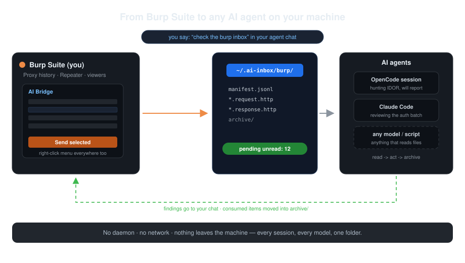
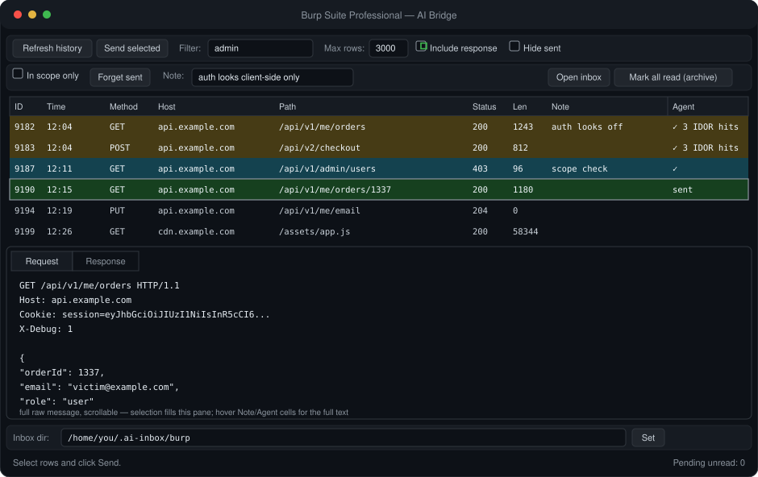

# burp-ai-bridge

A Burp Suite extension that writes selected HTTP requests and their responses to a
local folder on your machine. Any AI agent with filesystem access reads the folder,
acts on the requests, and marks them consumed. No daemon, no listening port, no
network egress beyond the requests themselves.

[](https://github.com/afshinShh/burp-ai-bridge/actions/workflows/ci.yml)
[](https://github.com/afshinShh/burp-ai-bridge/releases)
[](LICENSE)

## How it works

Selection happens in Burp (an "AI Bridge" tab listing proxy history, or a right-click
menu item on any message viewer). Sending writes, per item:

- `<timestamp>_<seq>_<host>.request.http` — the raw request as Burp saw it
- `<timestamp>_<seq>_<host>.response.http` — the response, unless disabled
- one JSON line in `manifest.jsonl` — host, port, TLS flag, method, path, HTTP
  version, status, and an optional note

Files land in `~/.ai-inbox/burp/` by default. Agents follow
[docs/agent-protocol.md](docs/agent-protocol.md): read pending files, replay or
analyze them, then move both files of a handled pair into `archive/`. The tab's
pending counter (refreshed every 2 s) tracks `*.request.http` files at the root, so
archiving drops it. Since the handoff is a plain directory, the same inbox is shared
by any number of agent sessions and models.

<p align="center">
  
</p>

## Install

1. Grab `AiAgentBridge.jar` from the [latest release](https://github.com/afshinShh/burp-ai-bridge/releases), or [build from source](#build-from-source).
2. Burp: `Extender → Extensions → Add`, type `Java`, select the jar.
3. An `AI Bridge` tab appears in the main window.

## Usage

- **AI Bridge tab:** `Refresh history`, ctrl/shift-select rows, fill `Note` if the
  batch needs context, `Send selected`.
- **Any message viewer:** right-click → `Send request to AI inbox`. With multiple
  tabs or rows selected the menu offers the whole selection. Also works in the
  proxy history bottom pane.
- `Note` is stored per item in the manifest; agents read it first.
- `Include response` (default on) controls whether `.response.http` files are written.
- Sent rows are tracked by request hash: each send action is one batch — every row
  from it gets the same highlight color (palette adapts to your Burp theme). The
  note shows in the `Note` column. This survives a Burp restart.
- `Hide sent` removes rows whose request already went to the box, so the list only
  shows what you haven't handed off yet. `Forget sent` drops the memory when you
  want to re-send previously handled rows (they still highlight/notes until you do).
- `In scope only` restricts the list to requests inside Burp's Target scope
  (Target → Scope). Off by default; when both filters are on they combine.
- The inbox path can be changed in the tab footer; the override persists.
- Checkbox states (`Include response`, `Hide sent`, `In scope only`) persist across
  restarts too.
- **Closing the loop** — the `Agent` column shows what happened after the hand-off:
  `sent` while the files wait, `✓` once an agent archives them, and the agent's
  short reply once it posts one. Checkbox picks are remembered.

On the agent side, ask in chat: `check the burp inbox and test what's there`.
Agents pull on request — see [Notes](#notes).

### Announce the path (once per machine)

Agents only read what their harness injects, so tell them where the inbox is once.
Append to the global instruction file of the agents you use:

```sh
cat >> ~/.config/opencode/AGENTS.md <<'EOF'
## burp inbox — AI Agent Bridge
- The Burp "AI Agent Bridge" extension sends selected requests to ~/.ai-inbox/burp/.
- Triggers: "check the burp inbox" / "hunt what's in the burp inbox".
- When triggered: read ~/.ai-inbox/burp/README.md (protocol), then manifest.jsonl (newest last).
  Pending = *.request.http at the root; responseFile references the captured responses.
- Read note first (sender intent). Act: analyze, replay (Burp MCP send_http1_request /
  send_http2_request using host/port/tls, or curl), report back in chat.
- Move BOTH files of each handled pair into ~/.ai-inbox/burp/archive/; never edit manifest.jsonl.
  Lines without a file field are lifecycle events; ignore them.
- Reply by APPENDING one JSON line per batch to ~/.ai-inbox/burp/results.jsonl:
  {"ts","batch","summary","by"} — batch is the id on the manifest lines you handled;
  the Burp tab shows your summary on the colored rows.
EOF
```

Equivalent locations: `~/.claude/CLAUDE.md` (Claude Code), project-root `AGENTS.md`
(scoped per workspace). OpenCode: without a project `AGENTS.md`, the global file above
is what every session sees.

<p align="center">
  
</p>

## Inbox format

```
~/.ai-inbox/burp/
├── manifest.jsonl    append-only JSON lines describing every item
├── results.jsonl     agent replies (one JSON line per batch, append-only)
├── *.request.http    pending items
├── *.response.http   optional companion files
├── archive/          consumed items, moved here by agents
└── README.md         the protocol, self-contained for fresh agent sessions
```

One line per item in `manifest.jsonl`:

```json
{"ts":"2026-01-01T12:00:00Z","id":9182,"file":"2026-01-01-120000-412_1001_api.example.com.request.http",
 "host":"api.example.com","port":443,"tls":true,"method":"GET","path":"/api/v1/me/orders",
 "httpVersion":"HTTP/1.1","proxyTime":"2026-01-01T11:59:58+00:00","status":200,
 "responseFile":"2026-01-01-120000-412_1001_api.example.com.response.http","source":"proxy-history",
 "note":"auth looks client-side only; test cross-account"}
```

| field | used for |
|---|---|
| `host`, `port`, `tls` | replay target for `curl` or Burp MCP `send_http1_request` / `send_http2_request` |
| `method`, `path`, `httpVersion` | replay mode; `HTTP/2` items are tagged explicitly |
| `file`, `responseFile` | raw message bytes, never truncated |
| `status` | shortlisting |
| `note` | the sender's intent |
| `source` | `proxy-history` or `message-editor` |
| `batch` | id shared by items sent together; the key agents use in `results.jsonl` |

Samples: [inbox-samples/](inbox-samples/). Agent contract:
[docs/agent-protocol.md](docs/agent-protocol.md). Worked examples:
[docs/use-cases.md](docs/use-cases.md).

## Build from source

Requires JDK 17+. By default the build fetches the official Montoya API artifact
from Maven Central and compiles locally:

```sh
./build.sh                     # -> AiAgentBridge.jar
```

To compile against an installed Burp build instead:

```sh
BURP_JAR=/path/to/burpsuite_pro.jar ./build.sh
```

Windows: `build.ps1` (PowerShell — run `powershell -ExecutionPolicy Bypass -File build.ps1`). CI compiles every push against
`net.portswigger.burp.extensions:montoya-api` and publishes the artifact:
[.github/workflows/ci.yml](.github/workflows/ci.yml).

## Notes

- Agents pull; they are not pushed. The pending counter tells you files are
  waiting; the trigger is one sentence in the agent's chat.
- `manifest.jsonl` is append-only and is never rewritten; `archive/` is the
  consumption cursor, which doubles as a hunt log. On long hunts the manifest
  rotates itself at 2 MB / 5000 lines: history moves to
  `archive/manifest-<stamp>.jsonl`, the live file keeps the newest entries.
- `results.jsonl` is the agent's half of the ledger — one short JSON line per
  batch, appended by the agent, read by the tab. Findings still go to chat;
  the summary line just closes the visual loop.
- Items from load and dir-change events also appear in the manifest, without a
  `file` field.
- Multiple Burp instances: point each at its own folder via the override.
- Nothing leaves the machine. The extension only writes the inbox directory and
  logs to Burp's extension output. Curate what you send — each send is a record
  of a real request. The inbox is `0700` (owner-only) on POSIX filesystems; it
  holds raw authenticated HTTP, so treat copies like secrets.
- Requires Burp Suite Pro or Community with the Montoya API (2023.10 or newer).
  Verified loaded on current releases.

## License

[MIT](LICENSE). © 2026 afshinShh.
