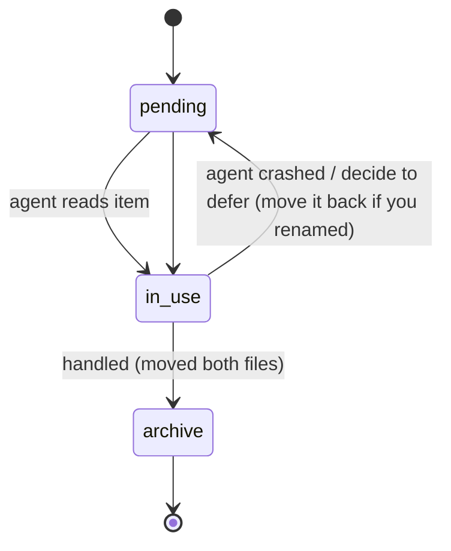

# Agent protocol: consuming the burp inbox

Version 1 · plain files at `~/.ai-inbox/burp` (override path is recorded in
`README.md` in the inbox itself). **Implementers:** this is the contract that
any agent can satisfy in a few lines of shell or a few hundred tokens of prompt.

> If you are an AI agent and you were pointed at this folder: the humans have
> selected these requests deliberately. Read everything below, then work.

## State model

```
~/.ai-inbox/burp/
├── manifest.jsonl          journal — append-only. Never edit it.
├── *.request.http          PENDING — someone wants an agent to look at these
├── *.response.http         PENDING — response captured alongside (optional incl.)
├── archive/                CONSUMED — moved here by the agent that handled them
└── README.md               the contract itself, always with the folder
```

- **Pending** = `*.request.http` in the folder root (not in `archive/`).
  The extension's "Pending unread" counter shows this live, so agents that
  archive correctly make the UI honest.
- **archive/** is the consumption cursor. It doubles as a hunt diary for
  later sessions.
- The folder must never be empty-empty: `manifest.jsonl` and `README.md` stay.



## Read order

1. `manifest.jsonl` — JSON lines, oldest→newest. Last pending line per `file`
   wins; skip lines without a `file` field (they're lifecycle events).
2. For each pending `file`, read the referenced `.request.http` file.
   Raw HTTP as Burp saw it. `responseFile` has the server's verdict.
3. Segment intent from `note` first — that's the human's judgment, the highest-
   signal field in the batch.

## Replay guidance

| manifest field | use |
|---|---|
| `host`,`port`,`tls` | targets for `send_http1_request` (Burp MCP) or `curl` |
| `method`,`path`,`httpVersion` | correct replay mode; `HTTP/2` → pseudo-header style / `send_http2_request` |
| `status` | shortlist: auth-boundary crossings, weird 40x/200 gaps |
| `source` | `proxy-history` = user-selected stream, `message-editor` = handpicked single |

Do **not** re-send the request to produce a response you already have in
`responseFile` — the human already paid for that round-trip.

## Consumption invariants (the deal)

1. **Move, don't mutate.** After handling an item, *both* files go to
   `archive/` unchanged. `manifest.jsonl` is never edited or rewritten.
2. **No locks.** One agent working one folder at a time; if two of you are
   alive, split by basename before either starts archiving.
3. **Report where the human expects it** — usually the chat of whoever asked.
   The inbox is input, not output.
4. **Respect scope.** Items are from the human's authorized testing. Your
   replay/exploit choices inherit that authorization; your finesse does not
   inherit the target's patience. Rate-limit like a professional.

## Design notes (for implementers)

- Files are complete raw messages, no truncation; binary bodies stay binary.
- One file per message keeps `grep -l`-able uniqueness and atomic moves.
- `manifest.jsonl` is append-only because append is the only safe operation
  when a Burp human and an AI share a file without coordination.
- The protocol is deliberately versionless; future fields are additions, and
  agents must tolerate unknown keys. Anything breaking that goes to v2 with a
  `protocol` field in every line.
